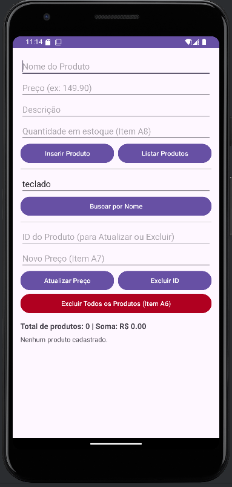
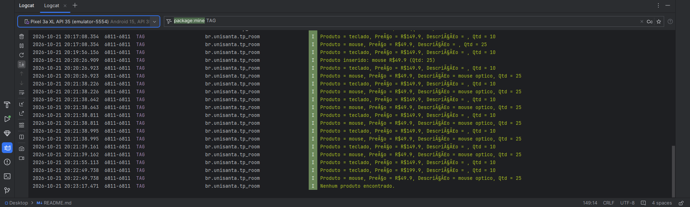

# AppRoomProduto (TP_ROOM): Cadastro de Produtos com Room SQLite

**Aluno:** Tompson Gabriel Rodrigues da Silva, Lucas Gama Oliveira dos Santos, Nicolas Rodrigues de Oliveira
**RA:** 241380, 243889, 244145
**Disciplina:** Programação para Dispositivos Móveis
**Professor(a):** Alessandro 

## Sobre o projeto
Aplicativo Android em Kotlin que cadastra, busca, atualiza, exclui e lista produtos usando persistência local com Room (SQLite).

## Tecnologias
- Kotlin
- Room 2.6.1 (SQLite)
- ViewBinding
- Corrotinas (lifecycleScope)

## Prints do app



---

## Parte A: Complemento prático

### A1. Limpar campos após inserir
**O que foi feito:** Após inserir o produto com sucesso no banco de dados dentro da corrotina (`lifecycleScope.launch`), foi utilizado o método `.text.clear()` em todos os campos de digitação (`EditText`) para limpar o formulário e o método `.requestFocus()` no campo `editProductName` para retornar o cursor automaticamente para o campo Nome.

**Trecho de código:**
```kotlin
binding.editProductName.text.clear()
binding.editProductPrice.text.clear()
binding.editProductDescription.text.clear()
binding.editProductQuantity.text.clear()
binding.editProductName.requestFocus()
```
**Print:**


### A2. Validação de preço
**O que foi feito:** Antes de salvar o produto, o valor digitado no campo de preço é convertido usando `toDoubleOrNull()`. Caso o valor seja nulo (campo vazio) ou menor/igual a zero (`<= 0.0`), o aplicativo bloqueia o cadastro e exibe um alerta visual diretamente no componente usando `binding.editProductPrice.error = "Informe um preço válido"`.

**Trecho de código:**
```kotlin
val price = priceText.toDoubleOrNull()
if (price == null || price <= 0.0) {
    binding.editProductPrice.error = "Informe um preço válido"
    binding.editProductPrice.requestFocus()
    return@setOnClickListener
}
```
**Print:**


### A3. Lista na tela
**O que foi feito:** Foi adicionado um `TextView` (`txtListaProdutos`) abaixo dos botões no layout `activity_main.xml` (envolvido por um `ScrollView`). Na `MainActivity`, a função `atualizarListaNaTela()` percorre os produtos retornados pelo Room e formata os dados com `joinToString`, exibindo toda a listagem diretamente na tela do aplicativo além do Logcat.

**Trecho de código:**
```kotlin
val textoFormatado = products.joinToString(separator = "\n\n") {
    "[ID: ${it.id}] ${it.name} - R$ ${"%.2f".format(it.price)}\nQtd: ${it.quantity} | Desc: ${it.description ?: "-"}"
}
binding.txtListaProdutos.text = textoFormatado
```
**Print:**


### A4. Total do estoque
**O que foi feito:** Foi adicionado o componente `txtTotalEstoque` acima da lista de produtos para exibir o resumo do estoque. A quantidade total de itens cadastrados é obtida com `products.size` e o valor financeiro somado é calculado com `products.sumOf { it.price }`.

**Trecho de código:**
```kotlin
val quantidadeCadastrados = products.size
val somaPrecos = products.sumOf { it.price }

binding.txtTotalEstoque.text =
    "Total de produtos: $quantidadeCadastrados | Soma: R$ ${"%.2f".format(somaPrecos)}"
```
**Print:**


### A5. Buscar por nome
**O que foi feito:** No `ProductDao`, foi declarada a função suspensa `buscarPorNome(nome: String)` anotada com `@Query("SELECT * FROM product WHERE name LIKE :nome")`. Na tela, foi adicionado um campo de busca e um botão que passa o texto formatado com curingas (`"%$termo%"`), permitindo localizar produtos por partes do nome.

**Trecho de código:**
```kotlin
// Em ProductDao.kt:
@Query("SELECT * FROM product WHERE name LIKE :nome")
suspend fun buscarPorNome(nome: String): List<Product>

// Em MainActivity.kt:
val termo = binding.editBuscarNome.text.toString().trim()
lifecycleScope.launch {
    val filtrados = productDao.buscarPorNome("%$termo%")
    atualizarListaNaTela(filtrados)
}
```
**Print:**


### A6. Excluir produtos
**O que foi feito:** Foram implementadas duas formas de exclusão no `ProductDao`: a exclusão total da tabela via `@Query("DELETE FROM product") suspend fun deleteAll()` e o desafio extra de exclusão individual por item usando a anotação `@Delete suspend fun delete(product: Product)` buscando pelo ID informado na tela.

**Trecho de código:**
```kotlin
// Em ProductDao.kt:
@Query("DELETE FROM product")
suspend fun deleteAll()

@Delete
suspend fun delete(product: Product)
```
**Print:**


### A7. Atualizar produto
**O que foi feito:** Foi criada a função `suspend fun update(product: Product)` com a anotação `@Update` no `ProductDao`, em conjunto com `getById(id: Int)`. Na interface, o usuário informa o ID do produto e o novo preço; o app recupera o registro, cria uma cópia com o preço atualizado (`.copy(price = novoPreco)`) e grava a alteração no banco.

**Trecho de código:**
```kotlin
// Em ProductDao.kt:
@Update
suspend fun update(product: Product)

// Em MainActivity.kt:
val produtoAtual = productDao.getById(id)
if (produtoAtual != null) {
    val produtoAtualizado = produtoAtual.copy(price = novoPreco)
    productDao.update(produtoAtualizado)
    atualizarListaNaTela(productDao.getAll())
}
```
**Print:**


### A8. Novo campo na tabela (`quantity`)
**O que foi feito:** Foi adicionado o atributo `quantity: Int` na entidade `Product`, incluído um `EditText` para a quantidade no layout XML e incrementada a versão do banco em `@Database(entities = [Product::class], version = 2)`. **Explicação do que aconteceu com os produtos já cadastrados e por quê:** Ao alterar a estrutura da entidade e subir a versão do banco de 1 para 2, todos os produtos que haviam sido cadastrados anteriormente foram apagados. Isso ocorre porque utilizamos o método `.fallbackToDestructiveMigration()` na construção do banco (`databaseBuilder`): quando o Room detecta que a versão subiu mas não encontra uma classe de `Migration` manual, ele destrói a tabela antiga e recria o banco do zero com a nova coluna `quantity`, evitando que o app sofra um crash (`IllegalStateException`).

**Trecho de código:**
```kotlin
// Em Product.kt:
@ColumnInfo(name = "quantity") val quantity: Int

// Em AppDatabase.kt:
@Database(entities = [Product::class], version = 2)
```
**Print:**


---

## Parte B: Questões dissertativas

### B1. O que é persistência de dados? O que aconteceria com os produtos cadastrados se, em vez do Room, eles fossem guardados apenas em uma MutableList dentro da MainActivity?
**Resposta:**
Persistência de dados é o conceito de armazenar informações em um meio não volátil (como o armazenamento interno do aparelho através de um arquivo SQLite), garantindo que os registros permaneçam gravados mesmo após o aplicativo ser fechado ou o celular ser desligado. Se os produtos do nosso projeto fossem guardados apenas em uma `MutableList<Product>` declarada dentro da `MainActivity`, esses dados existiriam exclusivamente na memória RAM (que é volátil) durante o tempo de execução daquela instância da Activity. Assim que o usuário fechasse o aplicativo, limpasse a lista de apps abertos ou até mesmo girasse a tela do celular (o que destrói e recria a Activity por padrão no Android), a variável da lista seria reinicializada vazia e todos os produtos cadastrados seriam perdidos imediatamente. Com o uso do Room no projeto, os dados são gravados fisicamente no arquivo `"database-name"`, permitindo que a chamada `productDao.getAll()` recupere tudo intacto a qualquer momento.

### B2. Qual é a diferença entre usar o SQLite diretamente (com SQLiteOpenHelper e comandos SQL manuais) e usar o Room? Cite pelo menos duas vantagens do Room.
**Resposta:**
Utilizar o SQLite diretamente com a classe `SQLiteOpenHelper` exige que o programador escreva manualmente todos os scripts SQL de criação e atualização de tabelas, gerencie abertura e fechamento de conexões e percorra objetos `Cursor` linha por linha para converter colunas em objetos Kotlin, gerando muito código repetitivo (*boilerplate*) e difícil de manter. O Room, por sua vez, atua como uma camada de abstração (ORM) sobre o SQLite que utiliza anotações (`@Entity`, `@Dao`, `@Database`) e geração de código via `kapt` para automatizar todo esse trabalho pesado. A primeira grande vantagem do Room é a **validação de consultas SQL em tempo de compilação**: se houver um erro de digitação no nome da tabela ou coluna dentro de `@Query`, o Android Studio aponta o erro antes mesmo de gerar o APK, evitando que o app feche inesperadamente na mão do usuário. A segunda vantagem é o **mapeamento automático para objetos Kotlin e suporte nativo a Corrotinas (`suspend`)**, retornando listas prontas (`List<Product>`) sem precisar manipular cursores ou `ContentValues` manualmente.

### B3. Explique o papel de cada uma das três peças do Room: Entity, DAO e Database. Como elas se relacionam no seu projeto?
**Resposta:**
A arquitetura do Room organiza a persistência local dividindo as responsabilidades em três componentes altamente coesos. A **Entity** (no nosso projeto, a `data class Product` anotada com `@Entity`) representa o modelo de dados e define o esquema da tabela `product` no banco, onde cada atributo da classe (`id`, `name`, `price`, `description`, `quantity`) corresponde a uma coluna física. O **DAO** (*Data Access Object*, representado pela interface `ProductDao` anotada com `@Dao`) é o contrato que define todas as operações de banco permitidas, expondo métodos suspensos em Kotlin (como `insertAll`, `getAll`, `buscarPorNome`, `update` e `deleteAll`) que o Room traduz automaticamente em instruções SQL. Já o **Database** (a classe abstrata `AppDatabase` anotada com `@Database`) funciona como o ponto de acesso principal ao arquivo SQLite do dispositivo: ele vincula as entidades registradas (`entities = [Product::class]`) ao DAO através do método abstrato `productDao()`, permitindo que a `MainActivity` obtenha uma instância funcional do DAO para gravar e consultar os produtos.

### B4. Por que o Android não permite acessar o banco de dados na thread principal (UI thread)? O que é um ANR (Application Not Responding)? Como suspend e lifecycleScope.launch resolvem esse problema?
**Resposta:**
O Android proíbe por padrão o acesso ao banco de dados na thread principal (*UI Thread*) porque essa thread é dedicada a desenhar os componentes visuais na tela (a 60 ou 120 quadros por segundo) e responder imediatamente aos toques do usuário. Operações de banco de dados realizam leitura e escrita em disco (I/O), que são tarefas lentas comparadas à memória RAM; se executadas na thread principal, elas bloqueiam a atualização da tela e causam travamentos visuais (*freezes*). Quando a thread principal fica bloqueada por mais de 5 segundos seguidos sem conseguir processar eventos de entrada, o sistema operacional dispara o erro de **ANR (*Application Not Responding*)**, exibindo uma janela que sugere ao usuário fechar o aplicativo. Para resolver isso no nosso projeto, adicionamos o modificador `suspend` nas funções do `ProductDao` (fazendo o Room executar o SQL em uma thread de segundo plano segura para I/O) e chamamos essas funções na `MainActivity` dentro do bloco `lifecycleScope.launch { ... }`, que inicia a corrotina sem travar a tela e a cancela automaticamente se a Activity for encerrada.

### B5. O que faz o fallbackToDestructiveMigration()? Por que ele é perigoso em um app publicado na Play Store? O que seria uma migração (Migration) de banco de dados?
**Resposta:**
O método `.fallbackToDestructiveMigration()` configura o Room para recriar o banco de dados do zero — apagando todas as tabelas e registros existentes — sempre que o número de versão (`version`) definido em `@Database` mudar e não houver uma regra de migração configurada. Durante o desenvolvimento em aula (como fizemos no item A8 ao adicionar a coluna `quantity` e mudar para `version = 2`), ele é muito útil para testar mudanças rápidas sem que o app feche com erro de esquema. Contudo, em um aplicativo publicado na Play Store, seu uso é extremamente perigoso porque **destrói todos os dados salvos pelos usuários reais** quando eles atualizam o app para uma versão nova. Em um ambiente de produção, o correto é implementar uma **Migration (Migração)**: uma classe onde escrevemos os comandos SQL de transição (por exemplo, `ALTER TABLE product ADD COLUMN quantity INTEGER NOT NULL DEFAULT 0`), permitindo que o Room atualize a estrutura da tabela da versão 1 para a versão 2 mantendo intactos todos os produtos já cadastrados pelo cliente.

### B6. Qual é a vantagem do ViewBinding em relação ao findViewById? Que tipo de erro ele ajuda a evitar?
**Resposta:**
O `ViewBinding` gera automaticamente uma classe de ligação (no nosso projeto, a `ActivityMainBinding`) a partir do arquivo XML `activity_main.xml`, entregando propriedades diretas para todos os componentes visuais que possuem um atributo `android:id`. Em relação ao tradicional `findViewById`, a grande vantagem prática é eliminar dezenas de linhas de código repetitivo de declaração e busca de views, permitindo acessar qualquer campo ou botão diretamente por `binding.editProductName` ou `binding.btnInserirProduto`. Além de deixar a `MainActivity` muito mais enxuta, o `ViewBinding` evita dois tipos de falhas críticas de execução: o **NullPointerException** (segurança contra nulos, pois não há risco de tentar buscar um ID inexistente ou que pertence a outro arquivo de layout) e o **ClassCastException** (segurança de tipos, já que cada propriedade gerada no `binding` já vem com o tipo exato do componente, como `EditText`, `Button` ou `TextView`, em tempo de compilação).

### B7. No tutorial, o banco é criado dentro da MainActivity. Por que em apps maiores é recomendado criar o banco como Singleton (uma única instância para o app inteiro)? O que poderia acontecer se várias telas criassem cada uma o seu banco?
**Resposta:**
Criar uma instância do Room através do `Room.databaseBuilder(...)` é uma operação pesada para o sistema, pois exige alocar buffers de memória, validar o esquema das tabelas e abrir conexões de leitura e escrita com o arquivo físico do SQLite no armazenamento interno. Em aplicativos maiores que possuem diversas Activities, Fragments ou ViewModels, se cada tela criasse sua própria instância do `AppDatabase`, o aplicativo sofreria com alto consumo de memória RAM e queda de desempenho. Além disso, ter múltiplas conexões independentes tentando ler e gravar simultaneamente no mesmo arquivo `"database-name"` pode causar conflitos de concorrência (*race conditions*), erros de bloqueio de tabela (*database lock*) e inconsistência de dados entre uma tela e outra. Ao aplicar o padrão de projeto **Singleton**, garantimos que o banco de dados seja instanciado apenas uma única vez na memória e reutilizado com segurança por todas as partes do aplicativo.

### B8. Reflexão pessoal: quais foram as principais dificuldades que você teve neste projeto e como as resolveu? Cite um app real (de comércio, estoque, saúde, escola etc.) em que a persistência local com Room seria útil e explique como você o aplicaria.
**Resposta:**
Ao longo do desenvolvimento deste projeto, a principal dificuldade técnica ocorreu no ambiente de execução do laboratório, onde o emulador padrão (API 35) apresentava fechamento inesperado devido à configuração gráfica, problema que foi diagnosticado e resolvido ajustando as configurações de *Emulated Performance (Graphics)* e limpeza de dados no *Device Manager*, além de validar o funcionamento conjunto das novas operações do DAO (busca com `LIKE`, `@Update` e `@Delete`) com a atualização dinâmica da tela. Como exemplo de aplicação em um cenário real, a persistência local com Room seria fundamental em um **aplicativo de gestão de estoque e controle de validade para uma rede de farmácias**. Nesse app, os funcionários poderiam registrar e consultar lotes de medicamentos, quantidades e datas de vencimento diretamente pelo celular em prateleiras ou depósitos sem sinal de internet (*offline-first*), salvando tudo em uma entidade `ProdutoFarmacia` no Room e sincronizando com o banco central apenas quando o dispositivo reconectasse ao Wi-Fi.

